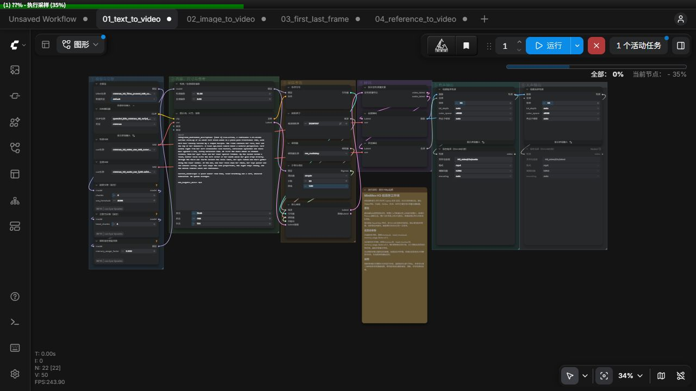

# MiniMax H3 低显存工作流｜8GB 显存实测

[English overview](README.en.md)

面向低显存显卡的 MiniMax H3 ComfyUI 工作流，支持文生视频、单首帧、首尾帧和多参考，提供原生 768p 配置及 8GB 显存实测记录。

| 项目 | 已验证配置 |
|---|---|
| GPU | NVIDIA RTX 5070 Laptop，8GB 显存 |
| 系统内存 | 约 32GB，生成时系统总占用峰值约 30GB |
| 生成规格 | 原生 1344×768，24 fps，124 帧约 5.17 秒 |
| 采样 | 20 步，res_multistep / simple |
| 模型 | INT8 主模型、32B NVFP4 AWQ 编码器、INT8 视频 VAE |
| 低显存处理 | 前馈分块、注意力头分块、采样显存预留控制 |
| 完整耗时 | 5 秒样例约 18–21 分钟，10 秒文生样例约 59 分钟 |

其他显卡、更小显存或更小系统内存的组合待验证。耗时和资源数据包含本机环境影响，具体结果随内容、硬件和后台程序变化。

## 四种生成模式

| 工作流 | 输入 | 使用场景 |
|---|---|---|
| [文生视频](workflows/01_text_to_video.json) | 提示词 | 从文字生成画面与声音 |
| [单首帧](workflows/02_image_to_video.json) | 一张首帧、提示词 | 从指定画面开始运动 |
| [首尾帧](workflows/03_first_last_frame.json) | 首帧、尾帧、提示词 | 描述起止画面之间的连续变化 |
| [多参考](workflows/04_reference_to_video.json) | 人物与环境参考、提示词 | 组合参考特征生成视频 |

每套均包含有声与无声保存分支。画布按模型与显存、内容与参考、采样、解码、有声输出、无声输出分区。

## 快速开始

1. 安装兼容的 ComfyUI 与 KJNodes，并准备已验证的 INT8 ConvRot 运行环境。
2. 下载五份模型到相应目录。仅使用前三种模式时，可暂缓下载 REF2VA 主模型。
3. 从本仓库下载所需 JSON，通过 ComfyUI 工作流打开功能或拖入画布导入。
4. 文生模式可直接修改提示词。参考模式先在 LoadImage 中上传自己的素材，保持 Picture 编号对应。
5. 首次运行沿用 1344×768、124 帧、20 步与默认分块。默认保存有声 MP4。

秋叶用户通过绘世启动器启动后导入工作流。已有 ComfyUI 用户使用自己的环境启动。安装前核对固定版本与运行条件。[安装与模型下载](docs/installation.md)

## 模型与节点

五份权重来自 Comfy-Org 的 MiniMax H3 转换仓库，模型路径位于 `diffusion_models`、`text_encoders` 和 `vae`。完整链接、文件大小与安装位置集中在安装文档。全部五份约 56.9 GiB。[模型来源](https://huggingface.co/Comfy-Org/MiniMax-H3)

自定义节点包为 KJNodes，使用 `MiniMaxChunkFeedForward`、`MiniMaxLowVRAMAttention` 和 `ModelMemoryUsageFactorOverride`。其余计算节点由匹配版本的 ComfyUI 提供。[KJNodes](https://github.com/kijai/ComfyUI-KJNodes)

## 低显存参数

| 参数 | 默认约 5 秒 | 约 10 秒 |
|---|---:|---:|
| width × height | 1344×768 | 1344×768 |
| length | 124 | 243 |
| fps | 24 | 24 |
| steps | 20 | 20 |
| 前馈 chunks | 4 | 16 |
| attention head_chunks | 4 | 16 |
| memory_usage_factor | 0.2 | 0.2 |

分块降低计算过程的显存峰值，同时增加调用和调度开销。显存预留参数影响权重驻留与采样激活空间。当前 8GB 配置使用系统内存协助承载模型，建议从已验证的约 32GB 系统内存条件开始。

帧数增加会显著提高序列计算和内存需求。10 秒耗时应参考实测，5 秒结果无法直接按比例外推。更改帧数时同时更新提示词时间，首尾帧还需更新尾帧时间。[使用与调参](docs/usage.md)

## 实测结果与限制

2026 年 11 月 7 日，以上硬件完成跨四种模式的五次连续完整生成。

| 模式 | 实际时长 | 完整耗时 |
|---|---:|---:|
| 文生视频 | 5.167 秒 | 17 分 33 秒 |
| 单首帧 | 5.167 秒 | 18 分 58 秒 |
| 首尾帧 | 5.167 秒 | 20 分 31 秒 |
| 多参考 | 5.167 秒 | 20 分 32 秒 |
| 文生视频 | 10.125 秒 | 59 分 15 秒 |

已检查有声与无声共十份 MP4 的尺寸、帧率、帧数、时长和音轨，两分支解码后的逐帧画面哈希一致。各模式分别连续五次的压力测试待进行。

多参考样例对第二张环境参考的遵循有限。其他 10 秒模式尚未实测。中文对白需逐条试听。当前工作流输出原生 768p，最终画面表现取决于提示词、素材和种子。[详细测量与验证范围](docs/benchmarks.md)

## 示例与素材

https://github.com/user-attachments/assets/a918928a-91ec-4604-ac32-15d8b59472d5

2026年11月10日发布复核的默认文生样例完整耗时17分30秒，实际1344×768、124帧、24 fps并含音轨。[下载AI生成样例视频](examples/ai-generated-t2v-768p.mp4)

参考入口使用 `first_frame.png`、`last_frame.png`、`subject_reference.png`、`scene_reference.png` 作为上传提示，导入后选择自己的图片。示例发布范围和来源记录见 examples 目录。[示例说明](examples/README.md)

## 许可与致谢

原创编排、原创提示词和新增文档采用 MIT 许可。ComfyUI、KJNodes、模型、第三方许可文本及媒体分别遵循其适用条款。H3 使用 MiniMax H3 Community License Agreement，包含地域和使用限制，使用前阅读上游许可。[本仓库 MIT 许可](LICENSE) · [第三方来源与许可](THIRD_PARTY_NOTICES.md) · [H3 上游许可](licenses/MiniMax-H3-LICENSE.txt)

感谢 MiniMax、Comfy-Org、Kijai 和 Qwen 团队。Powered by MiniMax H3。
